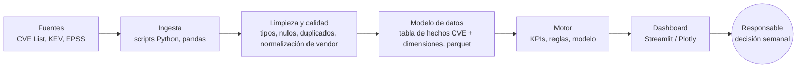

# Project brief: priorización de vulnerabilidades explotadas (CVE + CISA KEV + EPSS)

**Autor:** Adrian (foxploit) · **Curso:** Ciberseguridad y Data Intelligence, MSMK University · **Entrega:** capítulo 1 del Assignment Brief

## 1. Dataset

Trabajo con la lista pública de CVEs (identificadores de fallos de seguridad), unida al catálogo KEV de CISA (los explotados en el mundo real) y a EPSS de FIRST (probabilidad estimada de explotación en 30 días). Cada CVE trae su gravedad técnica CVSS (de 0 a 10) y su tipo de fallo CWE. La tabla principal tiene una fila por CVE y KEV aporta la variable objetivo: explotado (1) o no (0). KEV solo tiene 1.748 filas y no llega al mínimo de 5.000, por eso la base es la lista completa de CVEs.

### Ficha del dataset

| Campo | Respuesta |
|---|---|
| Nombre | CVEs publicados y su explotación conocida (CVE List + CISA KEV + EPSS) |
| Publicador y URL | MITRE / CVE Program: github.com/CVEProject/cvelistV5 · CISA: cisa.gov/known-exploited-vulnerabilities-catalog (espejo: github.com/cisagov/kev-data) · FIRST: first.org/epss |
| Licencia | KEV: CC0 1.0 (licencia en cisa.gov/sites/default/files/licenses/kev/license.txt). CVE List: licencia de MITRE, que permite reproducir y distribuir conservando su copyright. EPSS: FIRST EPSS Usage Agreement, uso libre y gratuito con atribución (first.org/epss/#Usage-Agreement) |
| Fecha de descarga y versión | Las tres fuentes descargadas el 18/10/2026. KEV: última entrada añadida el 16/10/2026. EPSS: modelo v2026.06.15, puntuaciones del 17/10/2026 |
| Grano | Una fila por CVE |
| Periodo cubierto | CVEs publicados del 01/01/2021 al 18/10/2026. KEV tiene altas desde el 03/11/2021 (ver limitaciones) |
| Tamaño | Tabla final: 236.253 filas × 14 columnas, 48,4 MB en memoria (CVE List de 2021 en adelante, unida a KEV y EPSS). KEV por separado: 1.748 filas × 12 columnas |
| Columnas clave | Fechas: publicación del CVE, `dateAdded` (alta en KEV). Dimensiones: `vendorProject`, `product`, CWE, vector de ataque, complejidad. Medidas: CVSS, `epss`, `percentile`. Objetivo: `en_KEV` (0/1) |
| Problemas de calidad ya vistos | Sin CWE el 35,3% de los CVEs y sin CVSS el 14,2% (33.641). Vendor y producto ausentes en el 0,4%, y 23.636 vendors distintos con nombres sin normalizar. EPSS falta en el 0,1%. Sin duplicados de `cveID`. CVSS en versiones distintas: v3.1 el 65%, v4.0 el 17%, v3.0 el 3%, v2.0 prácticamente nada. Desbalanceo fuerte: solo 1.043 CVEs en KEV (0,44%) |
| Otras fuentes | EPSS ya está unido (probabilidad de explotación en 30 días). NVD queda como opción para completar el 14% de CVEs sin CVSS |

## 2. Problema de negocio

### 2.1 Organización, departamento y stakeholder

- **Organización:** empresa mediana de servicios que gestiona su propia infraestructura (supuesto ilustrativo: unos 400 equipos y servidores expuestos).
- **Departamento:** el equipo de gestión de vulnerabilidades dentro de seguridad TI, 4 personas (supuesto) que despliegan parches con una ventana de mantenimiento semanal.
- **Stakeholder:** el responsable de vulnerabilidades. Abre el panel cada lunes y decide qué entra en la ventana de parcheo de esa semana. Puede cambiar el orden de parcheo y pedir una ventana de emergencia; no puede parchear todo.
- **Encaje y afectados:** la empresa quiere reducir su riesgo de incidentes sin ampliar plantilla. También afecta a los equipos de sistemas que aplican los parches y a los usuarios, que sufren las interrupciones de cada ventana.

### 2.2 Decisión

*Con esto, el responsable decidirá qué CVEs parchear primero cada semana, de entre los cientos que se publican.*

**Restricciones:** una sola ventana semanal con capacidad limitada de parches (supuesto: pocas decenas); no existe un inventario perfecto de activos; KEV está sesgado hacia productos usados por organismos de EE. UU.; solo se usan datos públicos, sin datos personales.

**Alternativas sin proyecto de datos:** parchear todo lo que tenga CVSS ≥ 7 (genera cientos de tareas, la mayoría sin explotación real) o parchear solo lo que ya esté en KEV (llega tarde, porque KEV es reactivo). El proyecto busca anticiparse a KEV.

### 2.3 Hipótesis

| | |
|---|---|
| **H1** | Los CVEs de ataque por red, sin autenticación y de baja complejidad llegan a KEV con más frecuencia que los de CVSS alto pero acceso local. |
| Métrica | Porcentaje de CVEs en KEV por combinación de vector, autenticación y complejidad. |
| Dirección esperada | Más alto en red + sin autenticación + complejidad baja. |
| Cómo se testea | Tabla cruzada y gráfico de barras de tasa de KEV por combinación; test chi-cuadrado, que indica si la diferencia entre grupos es real o casualidad (lecciones 03 a 05). |
| Si es cierta → | Se prioriza por vector de ataque antes que por CVSS. |
| Si es falsa → | Se mantiene la priorización por CVSS y se busca otra señal. |
| **H2** | EPSS separa mejor los CVEs explotados que CVSS. |
| Métrica | Mediana de EPSS y de CVSS en KEV frente a no KEV, y AUC de cada una (de 0,5 a 1: cuánto mejor separa los CVEs explotados de los demás). |
| Dirección esperada | AUC de EPSS mayor que la de CVSS. |
| Cómo se testea | Distribuciones por grupo y curva ROC, con el EPSS de los días posteriores a la publicación (ver sección 4). |
| Si es cierta → | El orden semanal usa EPSS como criterio principal. |
| Si es falsa → | Se usa CVSS y EPSS solo como desempate. |
| **H3** | Un grupo pequeño de vendors concentra la mayor parte de KEV. |
| Métrica | Porcentaje de KEV por vendor (Microsoft suma 390 de 1.748, un 22%; fuente: KEV, descarga del 18/10/2026). |
| Dirección esperada | Los 10 primeros vendors acumulan más de la mitad. |
| Cómo se testea | Diagrama de Pareto por vendor. |
| Si es cierta → | Se vigilan primero los productos de esos vendors en el inventario. |
| Si es falsa → | La priorización debe ser por CVE y no por vendor. |

**Prioridad por valor:** H2 primero, porque cambia el criterio con el que se ordena todo el parcheo; después H1, que lo afina; H3 al final, porque solo orienta qué vigilar.

### 2.4 KPIs

| KPI | Definición | Grano / dimensión | Objetivo |
|---|---|---|---|
| CVEs nuevos | Número de CVEs publicados | Por mes, vendor | Sin objetivo (contexto) |
| Tasa de KEV | CVEs en KEV ÷ CVEs publicados (H1, H3) | Por mes, vendor, vector | Seguimiento de tendencia |
| Días hasta KEV | Mediana de `dateAdded` − fecha de publicación | Por año de publicación | Reducir con el tiempo |
| Cobertura de EPSS | Porcentaje de los CVEs de KEV que el motor habría marcado entre el 10% de mayor riesgo antes de su alta (H2) | Por trimestre | Superar a la línea base de ordenar solo por CVSS (se mide en el bloque 3) |
| Carga de parcheo | CVEs en la lista semanal que superan el umbral del motor | Por semana | No superar la capacidad de la ventana (supuesto: pocas decenas) |

**Conflicto entre KPIs:** subir la cobertura obliga a meter más CVEs en la lista y eso sube la carga. Prefiero cubrir más KEV aunque aumente la carga, porque un parche omitido sale más caro que uno de más.

## 3. Solución

### 3.1 Tipo

**Motor analítico** como solución principal, con un **dashboard de gestión** que muestra su salida.

- **Entradas:** CVEs con sus atributos (vendor, producto, CWE, vector, CVSS), puntuación EPSS y etiqueta KEV.
- **Lógica:** reglas basadas en H1 a H3 y, en el bloque 3, un modelo de clasificación que estima la probabilidad de que un CVE llegue a KEV. Validación con partición temporal (entrenar con años anteriores, probar con los más recientes).
- **Salidas:** lista semanal ordenada de CVEs a parchear, con su puntuación, y el resumen de KPIs.

### 3.2 Arquitectura

| Capa | Qué hace | Herramienta | Refresco |
|---|---|---|---|
| Fuentes | Publican CVEs, explotación conocida y probabilidad | Repos y feeds públicos | KEV y EPSS diario, CVE List continuo |
| Ingesta | Descarga y guarda copia fechada | Python, requests, pandas | Diario |
| Limpieza y calidad | Une por `cveID`, normaliza vendors, trata nulos | pandas | Tras cada ingesta |
| Modelo de datos | Tabla de hechos de CVEs, dimensiones de vendor, fecha y CWE | Parquet | Diario |
| Motor | Calcula KPIs y puntuación | pandas, scikit-learn (bloque 3) | Semanal |
| Dashboard | Muestra KPIs y la lista semanal | Streamlit y Plotly | Semanal |

**Refresco y responsable:** yo mismo, con un script programado a diario. **Cambios de formato:** el esquema JSON de KEV es público y versionado, así que valido las columnas en la ingesta y falla de forma visible si cambian. **Dónde vive todo:** código y datos en mi repositorio, carpeta `project/`.

**Riesgos principales:**

1. Una fuente deja de publicarse o cambia sus términos de licencia.
2. La unión por `cveID` pierde filas o duplica por IDs mal formados.
3. Sesgo de KEV: que un CVE no figure no significa que no se explote, así que el modelo aprende "lo que CISA ha visto".

## 4. Limitaciones y ética

KEV empezó en noviembre de 2021, así que los CVEs anteriores no son comparables: pudieron explotarse sin entrar nunca en el catálogo. Por eso analizo solo los CVEs de 2021 en adelante, lo que deja fuera 705 de las 1.748 entradas de KEV y me deja 1.043 positivos. Los CVEs recientes figuran como "no KEV" porque aún no ha dado tiempo a que entren, así que los trataré aparte en el modelo. El EPSS descargado es el de hoy y puede incorporar ya las explotaciones recientes; para predecir de verdad usaré el EPSS de los días posteriores a la publicación, que FIRST publica por fecha. El vector de ataque solo existe para el 85,8% de los CVEs y mezcla versiones v3 y v4, así que H1 se contrasta solo con ellos. KEV refleja las prioridades del gobierno de EE. UU. y puede infrarrepresentar software muy usado en Europa. Los datos son públicos y sin datos personales, y el proyecto solo ordena el parcheo, sin generar código de explotación. Fuente de todas las cifras: mis descargas del 18/10/2026 de KEV, CVE List y EPSS, procesadas con `build_dataset.py`.

## 5. Fuentes

- CISA, Known Exploited Vulnerabilities Catalog: cisa.gov/known-exploited-vulnerabilities-catalog y github.com/cisagov/kev-data (CC0).
- MITRE, CVE List V5: github.com/CVEProject/cvelistV5.
- FIRST, Exploit Prediction Scoring System (EPSS): first.org/epss.
- NIST, National Vulnerability Database (opcional, solo si se usa para completar CVSS): nvd.nist.gov.
